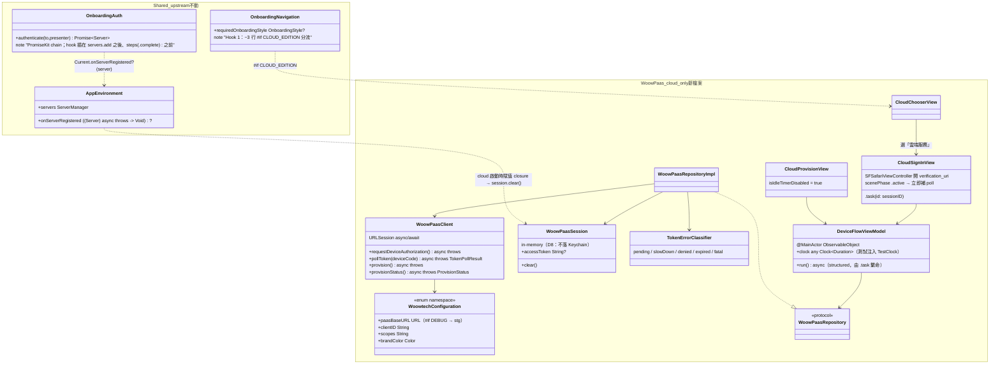
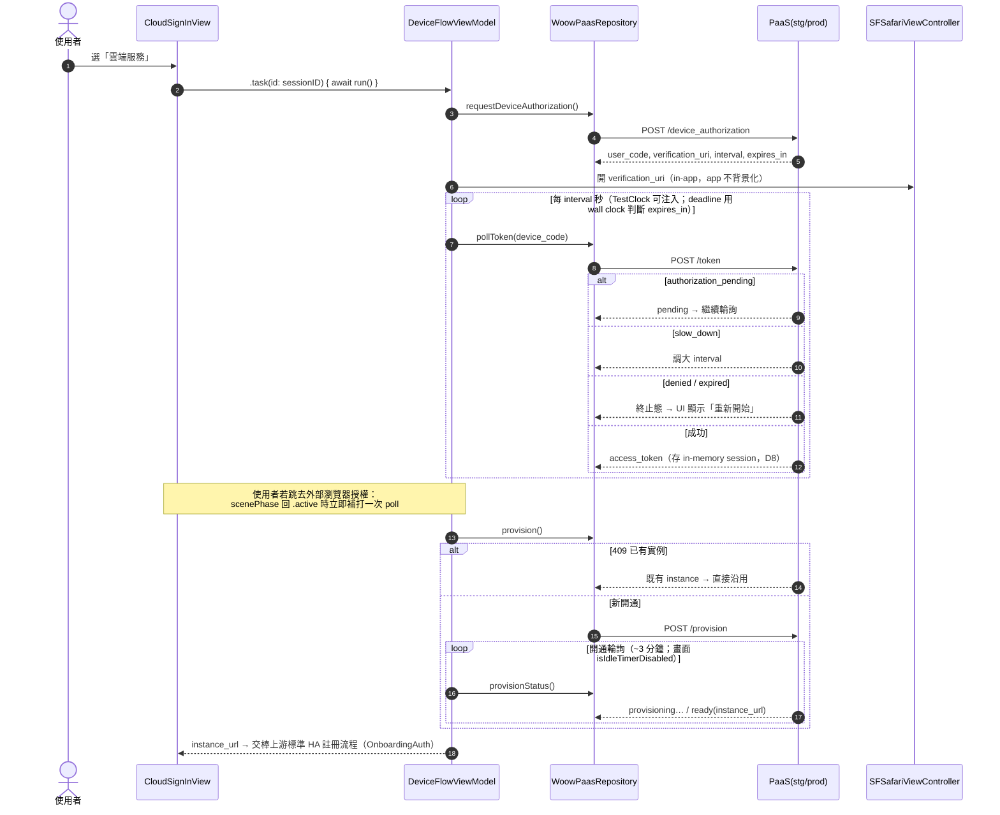
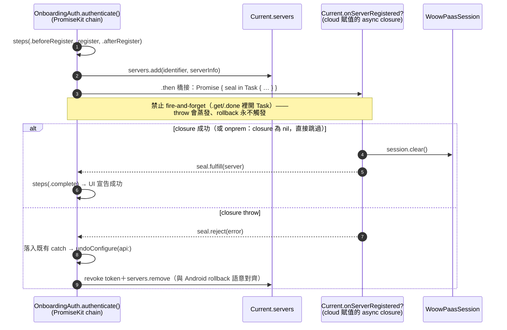

# PRD：woowtech 功能自 Android 移植至 iOS（地端／雲端 edition 分離）

日期：2026-08-29。v2（2026-08-30）：納入四人 review（架構／完整性／lifecycle／測試）與 Alan 三項裁決。
狀態：待 Alan 核准後動工。

來源真相：`~/woow_ha_app`（Android fork，PR #7 `feature/cloud-edition`，已通過真機 E2E 驗證）。
基底：官方 `home-assistant/iOS` main @ `9b4da789`（2026-08-29），**乾淨 clone**，非老闆的
`WOOWTECH/woow_ha_ios` 工具鏈（Alan 指示；關係見 §8）。

## 0. 決策記錄

| # | 決策 | 日期 |
|---|---|---|
| D1 | 先做 local branch（`feature/woowtech-port`）；遠端 repo 之後再定 | 08-29 |
| D2 | 兩個 bundle id，照 Android：`com.woowtech.home`（onprem）／`com.woowtech.homecloud`（cloud） | 08-29 |
| D3 | icon 暫用上游（老闆工具鏈有 `woowtech-icon.png` 素材，正式化時取用） | 08-29 |
| D4 | 品牌常數採老闆定案：`woowtech Home`、品牌藍 `#6183FC`、URL scheme `woowhome`、HA OAuth client_id `https://woowtech.github.io/woow_ha_ios/ios` | 08-29 |
| D5 | 不做 runtime 功能開關——build-time 隔離已達成目的 | 08-29 |
| D6 | PaaS 常數與 Android 一致：debug→`stg.woowtech.io`、release→`paas.woowtech.io`、client_id `woow-ha-app`、scopes `ha:provision workspace:read smarthome:read` | 08-29 |
| D7 | **Hook 2 降級**：不做 observer protocol＋陣列（review 判定過度設計），改為 `Current`（AppEnvironment）上**單一 optional async closure**，cloud edition 啟動時賦值（World pattern 原生寫法） | 08-30 |
| D8 | **PaaS session 記憶體持有、不落地**：device_code／token 生命週期短（≤ expires_in），app 被殺就重走流程；Keychain 殘留問題整個消失。若未來需要持久化，規則已寫死：`.afterFirstUnlockThisDeviceOnly`＋onboarding 入口冪等 purge | 08-30 |
| D9 | **測試策略採 review 版**：fixture＋expectations sidecar 當跨平台 contract；iOS **不建** Layer 2／Layer 3（理由見 §6）；輪詢測試用 swift-clocks `TestClock`；CI 雙 configuration build matrix | 08-30 |
| D10 | **App Store 5.1.1(v) 帳號刪除**：本次 port 不做，**延後到後續 commit**（Alan 裁決）。上架前必須補——這是硬性拒審條款，不是選配 | 08-30 |

## 1. Edition 分離機制

- 編譯旗標 `CLOUD_EDITION`（`SWIFT_ACTIVE_COMPILATION_CONDITIONS`，上游已有 `DEBUG`、`WIDGET_EXTENSION` 先例）。
- 兩組 xcconfig＋兩個 scheme；單一 App target（不複製 target——19 個 target 的 pbxproj 是 rebase 最易炸的檔案）。
- **`#if CLOUD_EDITION` 使用紀律（review 共識）**：
  1. 整檔包裹**只用在 cloud-only 檔案**（WoowPaas 資料層、三個畫面）；
  2. 共用檔案裡 `#if` **只准出現在兩個 hook 點**與 `OnboardingDestination` 的 case 擴散處；
  3. `@main`／entry point **禁止** `#if`——差異全走 xcconfig；
  4. **unit test target 的 xcconfig 也要定義 `CLOUD_EDITION`**，否則本機綠、CI 紅；
  5. cloud 字串放共用 string catalog（swiftgen 生成碼不吃 `#if`；onprem 二進位多幾條沒人引用的字串，代價最小）。
- 已知代價與對策：cloud 程式碼只在 cloud scheme 下編譯，另一版會默默腐爛——**Phase 0 就建立雙 scheme build 腳本**（build-only），CI 上是雙 configuration matrix（見 §6）。
- 動工前盤點：`OnboardingDestination` 是 enum，所有 exhaustive switch 的位置都要加 `#if` case——實際 hook 行數以盤點結果為準，不是「3＋2 行」的樂觀值。

## 2. 架構（class diagram）



對照 Android：`WoowPaasClient/Repository/Session/TokenErrorClassifier` ↔ `:cloud-data` 模組；
`DeviceFlowViewModel`＋三 View ↔ `app/src/cloud` 三畫面；`Current.onServerRegistered` ↔
`ServerRegisteredListener`（Android 用 Hilt @Multibinds 集合是因為 Hilt 的慣用語；iOS 的 World
pattern 慣用語是單一 closure——**兩邊各自用自己平台的正統寫法，語意等價**）。

## 3. 關鍵流程（sequence diagrams）

### 3.1 Device Flow 登入＋開通（Hook 1 之後的主路徑）



### 3.2 Hook 2：註冊完成 → session 清理（含 rollback 語意）



插入點必須在 `steps(.complete)` **之前**（UI 宣告成功後才回滾＝狀態機爛掉）。closure 保持
`throws` 簽名以固定 rollback 語意；MVP 的清理實作自吞儲存錯誤（同 Android），實際不會 reject。
closure 內禁止長時操作（PromiseKit 無 cancellation，chain 被棄時 Task 不會被取消）。

## 4. Lifecycle 規則（review 定案，實作必遵守）

1. 輪詢＝**structured async func**，由 `.task(id: sessionID)` 繫生命週期（等價 viewModelScope）；ViewModel **禁止**自存 unstructured `Task {}`。`CancellationError` 是正常路徑（使用者返回），不得映射成錯誤畫面。
2. `expires_in` 用 **wall clock deadline** 逐圈檢查，不數迭代次數（app 凍結後醒來時間已跳）。
3. 授權用 **`SFSafariViewController` in-app 開**（app 保持 foreground、輪詢不中斷）；若使用者仍跳出，`scenePhase == .active` 時**立即補 poll**。URLSession `waitsForConnectivity = true`，單次 poll 失敗重試、不中止迴圈。
4. Provision 畫面 `isIdleTimerDisabled = true`（onDisappear 還原），防自動鎖屏凍結輪詢。
5. Session（D8）memory-only；onboarding 入口仍做冪等 `session.clear()`（防禦性，成本一行）。
6. device_code／token 禁入 `UserDefaults(AppGroupID)`、禁入共享 keychain access group（Watch／extension 不需要 PaaS session）。

## 5. Function 清單

**A. 品牌（onprem 基底）**：bundle id 公式覆寫＋3 處 hardcode（WatchWidgets×2、WatchAppTests）；
`AppConstants.BundleID` 後綴表；`CrashReporter.swift:21`（`io.robbie.` 前綴檢查）；
`LocalPushEvent.swift:55`；App Group entitlement；`PRODUCT_NAME`（pbxproj 2 處＋3 個 Info.plist
hardcode）；fork 字串放獨立 `Woowtech.strings` 表（Lokalise nightly 會洗掉 `Localizable.strings`）；
停用上游 Lokalise×3 與上架 workflows。

**B. 雲端（逐檔對應 Android `:cloud-data`＋`app/src/cloud`）**：Device Flow client、DTOs、
`TokenErrorClassifier`、in-memory session＋Hook 2 清理、三畫面含 denied→重新開始、409 沿用既有實例。

**C. 不移植**：FailFast/StrictMode（Android 專屬）、`IS_FULL`、full/minimal dimension、runtime 開關（D5）、
Android 的 session 持久化（D8 改 memory-only）。

**D. 延後（記錄在案，非遺漏）**：App 內帳號刪除（D10，後續 commit；上架前必補）。

## 6. 測試（D9 定案）

**iOS 只有一層（Tests-Unit scheme），不建 Layer 2／Layer 3**：
- iOS 的 OHHTTPStubs 走 URLProtocol＝unit scheme 裡就是真的 URLSession pipeline，Android 需要
  instrumentation 才能跑真網路棧的前提在 iOS 不存在 → 不需要獨立 Layer 2。
- Drift detector 一個就夠（Android Layer 3 nightly 已盯同一個 PaaS）→ iOS 不建 nightly E2E；
  「模擬器手動 E2E 打 prod」降為 release checklist 項目。
- **不做**：Pact 全套、XCUITest 自動化 device flow（中途開瀏覽器＝by construction flaky）、
  每畫面每狀態 snapshot 矩陣、自建 URLSession mock 層。

**Fixture 鐵律（承 Android）＋sidecar contract（新）**：
- mock 回應禁止手寫，一律用 Android Layer 2 錄自真流量的同一批 `paas-fixtures`。
- **每份 fixture 配 `*.expected.json` sidecar**（解碼後各語意欄位的 canonical 值）；兩平台測試
  都逐欄位 assert against sidecar——堵住 kotlinx.serialization vs Codable 預設行為差異
  （未知欄位／缺欄位補 default vs optional-nil／snake_case 漏標／ISO8601 小數秒）造成的
  「兩邊都綠但語意分岔」假信心。**禁止「decode 不炸就算過」的測試**。
- fixture＋sidecar 事實上就是 API contract（兩個 consumer＋Android nightly 當 provider
  verification）；P4（OpenAPI）到手前不加任何 contract 工具。
- **時序依賴**：iOS fixture 測試 block 在 Android 錄製 PR 之後，禁止「先手寫暫時版」。

**測試清單**：
```
WoowPaasFixtureContractTests
  decodedValues_matchExpectationsSidecar(fixture:)      // 參數化，蓋全部 fixture
DeviceFlowPollerTests                                   // 注入 TestClock（swift-clocks，上游已有）
  pendingThenSuccess_pollsAtRecordedInterval_thenReturnsToken
  slowDown_increasesPollInterval
  accessDenied_stopsPolling_surfacesDeniedState
  expiredToken_stopsPolling_surfacesExpiredState
  cancellation_midPoll_stopsWithoutTokenWrite
WoowPaasRepositoryTests                                 // OHHTTPStubs 重放 fixture
  provision_on409_reusesExistingInstance
  tokenRefresh_rotation_persistsNewRefreshToken
  serverError500_propagatesError_notSwallowed
CloudOnboardingStubbedFlowTests
  fullDeviceFlow_deviceCodeToPendingToTokenToProvision_reachesConnectedState
CloudEditionNavigationTests
  cloudEdition_onboardingStartsAtDeviceFlowScreen
  onpremEdition_onboardingStartsAtUpstreamFlow
HookRollbackTests
  observerThrow_serverAbsentFromCurrentServers          // rollback 語意
  observerSuccess_completeStepReached
```
**CI（非測試但必要）**：雙 configuration（onprem／cloud）**都至少 build**——`#if` 架構下
「另一版根本沒編譯」是測試網最大的洞，此項 CP 值最高。

## 7. 開放決策（P0，需 Alan／產品拍板；不擋 Phase 0–1 動工）

| # | 議題 | 現況 | 選項 |
|---|---|---|---|
| O1 | **遠端推播鏈路**：上游 iOS 推播綁 HA 官方 push server（`io.robbie.HomeAssistant`＋HA 的 APNs 憑證），換 bundle id 後遠端推播歸零；雲端版使用者（永遠遠端連線）＝零通知 | 未決 | (a) 自架 push server＋WOOWTECH APNs key（要人力/SLA）(b) 明寫「iOS 版無遠端通知」為產品限制 (c) 首版只出地端版 |
| O2 | **App Store 3.1.1**：app 內開通「會收費的」雲端主機 → IAP 抽成風險；審查員 demo 帳號策略 | 未決 | 需商業模式輸入；3.1.3「跨平台已購服務」是可能的主張路徑 |
| O3 | **Watch app 行為**：雲端版的 Watch 拿不拿得到 hosted instance session？ | 未定義 | port（沿上游 WatchConnectivity 傳 server 設定，理論上自動可用——需驗證）或首版明寫不支援 |
| O4 | **URL scheme 矩陣**：`homeassistant://` vs `woowhome`；兩個 bundle id 同 scheme 互搶；client_id 的 github.io redirect 頁誰維護 | 未決 | 建議：onprem＝`woowhome`、cloud＝`woowhomecloud`，並確認 redirect 頁存在 |
| O5 | **Apple 申請項提前**：WOOWTECH Developer Team、CarPlay entitlement（審批以週/月計）、Thread credentials | 未申請 | 申請動作 Phase 0 就發出，不等 Phase 4 |
| O6 | **iOS debug 過 CF-Access**（stg）＋prod 測試的 instance teardown 責任 | 沿 Android P1 | 與 Android 共用同一張 PaaS 團隊 ticket |

## 8. 與老闆 white-label 工具鏈的關係（v2 修正承諾顆粒度）

工具鏈釘在舊 upstream tag（2026.7.3），是純品牌重貼（無雲端）。**可整包搬移的**：
`WoowPaas` 資料層（自足 async/await、不碰 PromiseKit）、fixtures＋sidecar＋單元測試、三個
View/ViewModel 本體。**每個 base 版本需重做的**：兩個 hook 與導航接線（`requiredOnboardingStyle`
／`OnboardingDestination`／`OnboardingAuthPresenter` 都是 SwiftUI onboarding 重寫後的符號，
舊 tag 上不存在）。品牌常數與其 `woowtech-ios.conf` 一致（D4），不造第二套真相。

**常數 source of truth 規則**：build system 需要的（bundle id、App Group、PRODUCT_NAME）住
xcconfig；只有程式碼需要的（PaaS URL、client_id、品牌色）住 `WoowtechConfiguration`；禁止鏡像。
stg/prod 用 `#if DEBUG`，不繞 Info.plist。

## 9. Phases

| Phase | 內容 | 出口條件 |
|---|---|---|
| 0 | 品牌＋兩組 xcconfig／scheme＋**雙 scheme build 腳本**＋`OnboardingDestination` switch 盤點＋O5 申請發出 | 兩 edition 模擬器可跑；雙 build 綠 |
| 1 | WoowPaas 資料層＋sidecar contract 測試＋poller 測試（fixture 依賴 Android 錄製 PR） | §6 清單前三組綠 |
| 2 | 三畫面＋兩個 hook＋lifecycle 規則落地 | onprem 二進位驗證無雲端符號；HookRollbackTests 綠 |
| 3 | 模擬器 E2E 打 prod（一次性驗證，之後降 release checklist） | 開通到活的 HA 實例 |
| 4 | CI 雙 config matrix（macOS runner，public repo 免費）；簽章／上架另案（依 O5） | PR gate 綠 |

## 10. 風險

- 本機 Xcode：已裝 26.3（Build 17C529，iOS 26.2＋watchOS 26.2 SDK）；上游 main 的 9 處
  `#available(iOS 26.4)` 皆為行為閘門、無新 SDK 符號，26.3 靜態分析可編——以實編驗證為準（進行中）。
- 簽章：模擬器開發不受影響；實機／上架依 O5。
- 遠端 repo（D1）：工作僅存本機，儘早定 remote。
